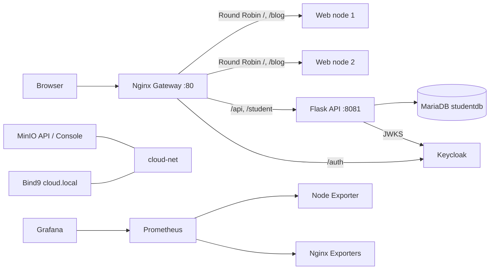

# Báo cáo cuối kỳ — MyMiniCloud, Nhóm 19

> Bản này ghi lại cấu hình trong repository. Những kết quả phụ thuộc môi trường (ảnh chụp, AWS, Docker Hub, URL public) phải được nhóm chạy và bổ sung; không coi cấu hình là bằng chứng đã triển khai.

## Chương 1. Giới thiệu và mục tiêu

MyMiniCloud mô phỏng các thành phần thường gặp trong một nền tảng cloud bằng các container Docker trên network `cloud-net`: web tĩnh, Flask API, MariaDB, Keycloak, MinIO, Bind9, Prometheus/Node Exporter, Grafana và Nginx Gateway. Hai web node và Nginx Exporter được dùng làm node phụ trợ cho demo cân bằng tải và giám sát.

## Chương 2. Kiến trúc và luồng request

Compose gán địa chỉ tĩnh trong `10.10.10.0/24` để zone `cloud.local` dùng được các địa chỉ A records thống nhất. Các service cũng có thể phân giải nhau bằng DNS tích hợp của Docker Compose.

## Chương 3. Cấu hình và triển khai

- Mỗi service có thư mục riêng; root `docker-compose.yml` tích hợp toàn stack. Cấu hình môi trường lấy từ `.env` (tạo từ `.env.example`).
- Backend Flask cung cấp `/hello`, `/student`, `/students-db` và `/secure`. Hai API sinh viên đọc cùng MariaDB, tránh dữ liệu JSON và database lệch nhau.
- MariaDB tạo bảng `studentdb.students` với `student_id`, `fullname`, `dob`, `major`, `gpa` và năm bản ghi mẫu.
- Keycloak import realm `realm_52300070`, public client `flask-app` có audience mapper; container init tạo hai user `sv01`, `sv02` với password lấy từ `.env`.
- MinIO giữ data qua bind mount, tạo các bucket `demo`, `profile-pics`, `documents` bằng tác vụ init.
- Gateway định tuyến web, `/api/`, `/student`, `/auth/`; upstream web dùng Round Robin mặc định.
- Prometheus scrape Node Exporter, hai Nginx Exporter và chính Prometheus. Grafana provision datasource và dashboard từ file.
- Cổng dịch vụ quản trị bind vào localhost; cổng Gateway là cổng public duy nhất theo mặc định.

## Chương 4. Demo và kiểm thử

Sau khi chạy `docker compose up --build -d`, nhóm cần ghi nhận:

| Hạng mục | Kiểm tra | Minh chứng cần chèn |
|---|---|---|
| Web/blog | `http://localhost/`, `/blog/` | Đã kiểm tra qua Gateway; cần chèn ảnh trang chủ và blog. |
| Backend | `/api/hello`, `/student` | Đã nhận JSON; `/student` trả 5 sinh viên. |
| Database | `/students-db` | Đã nhận 5 dòng từ `studentdb`. |
| Keycloak/OIDC | lấy token, gọi `/secure` | Đã lấy token cho `sv01`; `/secure` trả `Secure resource OK`. Cần chèn ảnh không chứa token/secret. |
| MinIO | Console, buckets và objects | Đã tạo 3 bucket; `index.html` và `avatar.jpg` đã nạp. PDF không có trong working tree. |
| DNS | `named-checkzone`, `nslookup` | Zone hợp lệ; `app-backend.cloud.local` phân giải về `10.10.10.20`. |
| Prometheus | `/targets` | Đã kiểm tra 4/4 targets `UP`. |
| Grafana | dashboard System Health | Health `ok`; datasource và dashboard đã provision. Cần chèn ảnh ba biểu đồ. |
| Gateway/LB | route API và header `X-Served-By` | Đã nhận header luân phiên giữa `web-frontend-server1` và `web-frontend-server2`. |
| AWS/Docker Hub | URL public và image tags | Chưa triển khai; bổ sung sau khi nhóm thực hiện thật. |

## Chương 5. Đánh giá và hướng mở rộng

Thiết kế tách service, dùng network riêng, cấu hình qua biến môi trường và có data volumes; Gateway gom đầu vào, OIDC bảo vệ API, còn metrics hỗ trợ quan sát hệ thống. Đây là môi trường học tập/dev: Keycloak chạy `start-dev`, Flask dùng server tích hợp và MinIO single-node, không phù hợp production. Hướng mở rộng gồm HTTPS/TLS, reverse proxy trust boundaries, user/role authorization, backup/restore, health-based failover, container metrics exporter và triển khai có quản lý secret.

## Phụ lục — trạng thái đối chiếu yêu cầu

- [x] Blog 3 bài có liên kết và ảnh trong hai web node.
- [x] API `/student` trả dữ liệu từ database; `/students-db` trả dữ liệu quan hệ.
- [x] Database schema theo đề, có 5 sinh viên.
- [x] Realm/client/users được khai báo để Keycloak import.
- [x] MinIO tạo ba bucket; mẫu ảnh và HTML được nạp.
- [x] DNS zone có các bản ghi web/app/db/Keycloak/MinIO/Gateway.
- [x] Prometheus scrape Node Exporter, Nginx Exporter và chính Prometheus.
- [x] Grafana dashboard có CPU/RAM/Network và datasource provision.
- [x] Gateway có route `/student` và `/api/`; Round Robin cho hai web node.
- [ ] PDF báo cáo chưa có trong working tree nên MinIO chưa thể nạp PDF.
- [x] Stack đã build và chạy local; API/DB, OIDC, DNS, MinIO, Prometheus/Grafana và Round Robin đã được kiểm tra.
- [ ] Chưa có ảnh/video minh chứng, Docker Hub push hoặc AWS EC2 deployment.

### Thông tin nhóm cần hoàn thiện trước khi nộp

1. Tên thành viên, MSSV, môn học, giảng viên, ngày báo cáo.
2. Ảnh chụp kết quả từng dòng kiểm thử ở Chương 4.
3. Link Docker Hub, video demo, public URL EC2 và log triển khai sau khi nhóm thực hiện.
4. PDF báo cáo nếu cần đưa vào bucket `documents`.
