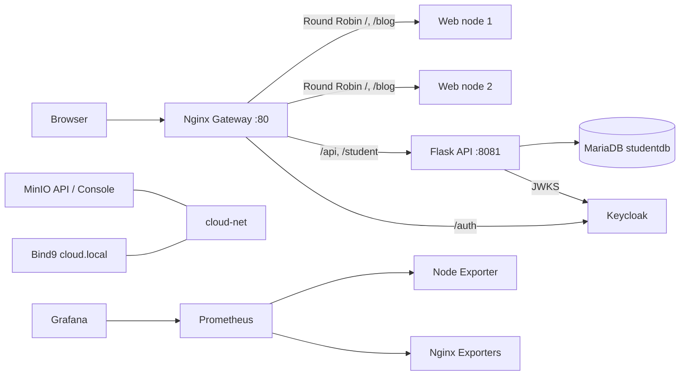

# Báo cáo cuối kỳ — MyMiniCloud, Nhóm 19

> Báo cáo này đối chiếu đề `Báo Cáo Cuối Kỳ.docx` với cấu hình hiện có trong repository. Các ảnh, log và kết quả phụ thuộc môi trường phải được nhóm chạy, lưu lại và bổ sung; cấu hình trong mã nguồn không tự chứng minh dịch vụ đã chạy thành công.

## Chương 1. Giới thiệu và mục tiêu

MyMiniCloud mô phỏng chín vai trò máy chủ trong một nền tảng cloud: Web, Application, Database, Authentication, Object Storage, DNS, Monitoring, Logging/Visualization và Reverse Proxy/Load Balancer. Các vai trò chạy trong Docker Compose trên network `cloud-net`; hai web node, Node Exporter, hai Nginx Exporter và các container khởi tạo dữ liệu là thành phần phụ trợ.

## Chương 2. Kiến trúc và luồng request

Compose gán địa chỉ tĩnh trong `10.10.10.0/24` để zone `cloud.local` phân giải các service bằng bản ghi A. Các container cũng có thể phân giải tên service qua DNS tích hợp của Docker Compose. Gateway là điểm vào HTTP; cổng quản trị được bind vào loopback theo mặc định.

## Chương 3. Cấu hình và triển khai

Compose gốc `docker-compose.yml` tích hợp các vai trò và cấu hình network; biến môi trường lấy từ `.env` được tạo từ `.env.example`. Cấu hình hiện có theo từng vai trò:

| Vai trò | Service/container | Dockerfile/cấu hình chính | Cổng host mặc định và lưu trữ |
|---|---|---|---|
| Web | `web-frontend-server`, `web-frontend-server2` | `web-frontend-server/Dockerfile`, `web-frontend-server2/Dockerfile`, trang tĩnh và blog | Gateway `:80`; node trực tiếp `:18080`, `:18082` |
| Application | `application-backend-server` | `application-backend-server/Dockerfile`, Flask API `/hello`, `/student`, `/students-db`, `/secure` | API trực tiếp `:18085`, container `:8081` |
| Database | `relational-database-server` | MariaDB; `relational-database-server/init/001_init.sql` | `:13306`; named volume `database-data` |
| Authentication | `authentication-identity-server` | Keycloak; `authentication-identity-server/realm/realm_52300070.json`; `init-users.sh` | `:18081`; named volume `keycloak-data` |
| Object Storage | `object-storage-server` | `object-storage-server/Dockerfile`, `scripts/init-buckets.sh` | API `:9000`, Console `:9001`; bind mount `object-storage-server/data` |
| DNS | `internal-dns-server` | Bind9; `named.conf*`, `db.cloud.local` | `:1053` TCP/UDP |
| Monitoring | `monitoring-prometheus-server` | `monitoring-prometheus-server/prometheus.yml`; Node Exporter và hai Nginx Exporter | Prometheus `:9090`; named volume `prometheus-data` |
| Logging/Visualization | `monitoring-grafana-dashboard-server` | Grafana provisioning và `Grafana_Dashboard.json` | `:3000`; named volume `grafana-data` |
| Reverse Proxy/Load Balancer | `api-gateway-proxy-server` | `api-gateway-proxy-server/Dockerfile`, `nginx.conf` | `:80`; định tuyến API/auth và cân bằng tải web |

Các service chính dùng `restart: unless-stopped`; tác vụ khởi tạo dữ liệu chạy một lần. Database, Keycloak, Prometheus và Grafana có named volume; MinIO dùng bind mount để giữ dữ liệu. Những cổng quản trị được giới hạn vào `127.0.0.1` theo mặc định; chỉ Gateway được cấu hình để đổi bind address khi triển khai EC2.

Backend lấy dữ liệu sinh viên từ MariaDB, không dùng file `students.json`. Schema hiện có thêm cột `gpa` so với schema tối thiểu của đề. Script SQL chứa **5 bản ghi** như yêu cầu; họ tên của bản ghi `SV005` hiện còn chưa đầy đủ và cần được nhóm xác nhận trước khi nộp.

Keycloak import realm `realm_52300070`, public client `flask-app` có audience mapper; tác vụ init tạo `sv01` và `sv02` với mật khẩu lấy từ `.env`. MinIO init tạo bucket `demo`, `profile-pics`, `documents`, nạp `index.html` và `avatar.jpg`; file PDF báo cáo chưa có trong thư mục sample. Gateway chuyển `/api/` tới Flask, `/student` và `/student/` tới endpoint sinh viên, `/auth/` tới Keycloak; upstream web gồm hai node theo Round Robin mặc định.

Prometheus hiện scrape Node Exporter, hai Nginx Exporter và chính Prometheus. Grafana provision datasource Prometheus và dashboard có ba panel CPU, Memory, Network. Đề yêu cầu thêm scrape target trực tiếp `web-frontend-server:80`; cấu hình hiện tại chưa có target đó, thay vào đó dùng Nginx Exporter để lấy metrics của hai web node.

## Chương 4. Demo và kiểm thử

Đề yêu cầu ảnh minh họa từng server, log kiểm thử và kết quả thực tế. Bảng dưới ghi kết quả smoke test hiện tại; nhóm vẫn cần lưu ảnh/log làm minh chứng nộp bài. SQL thiếu dấu phẩy trước `SV005` ở lần khởi tạo đầu, đã được sửa và chạy lại; endpoint hiện trả đủ 5 dòng.

| Hạng mục | Kiểm tra đề xuất | Trạng thái theo repository / minh chứng cần bổ sung |
|---|---|---|
| Web/blog | `http://localhost/`, `/blog/` | Có trang chính, ba bài blog, ảnh và liên kết trong mã nguồn; cần ảnh trang đang chạy. |
| Backend | `/api/hello`, `/student` | `/api/hello` trả HTTP 200; `/student` trả HTTP 200 và 5 dòng sau khi chạy lại seed. |
| Database | `/api/students-db`, kiểm tra schema | `/students-db` trực tiếp và `/api/students-db` qua Gateway đều trả HTTP 200, 5 dòng. |
| Keycloak/OIDC | đăng nhập, lấy token, gọi `/secure` | Lấy token cho `sv01` thành công; `/secure` trả `Secure resource OK`. Cần lưu ảnh/log và che token/mật khẩu. |
| MinIO | Console, bucket/object | Init log xác nhận ba bucket và hai file mẫu đã nạp; PDF chưa có nên yêu cầu upload PDF chưa đạt. |
| DNS | `named-checkzone`, `nslookup` | Zone hợp lệ; `app-backend`, `minio`, `keycloak` phân giải lần lượt tới `10.10.10.20`, `.50`, `.40`. |
| Prometheus | `/targets` | API targets trả 4/4 `UP`; chưa có scrape target trực tiếp `web-frontend-server:80` như đề. |
| Grafana | dashboard và ba panel | Health endpoint trả HTTP 200; JSON có datasource Prometheus và ba panel; cần ảnh dashboard có dữ liệu. |
| Gateway/LB | route API và `X-Served-By` | `/healthz` trả HTTP 200; header `X-Served-By` luân phiên giữa hai web node trong 6 lần gọi. |
| Trạng thái stack | `docker compose ps` | Các service chính đang chạy; hai tác vụ init kết thúc với exit code 0 như thiết kế. |
| Kết nối mạng | kiểm tra các service trong `cloud-net` | DNS nội bộ phân giải thành công các bản ghi app, MinIO, Keycloak. |
| AWS/Docker Hub | image tag, public IP và kiểm thử endpoint | Chưa có bằng chứng push image hoặc triển khai EC2; chỉ bổ sung sau khi chạy thực tế. |

## Chương 5. Đánh giá và hướng mở rộng

Ưu điểm là các vai trò được tách thành service, dùng network riêng, cấu hình bằng biến môi trường, có lưu trữ bền vững và có Gateway cùng OIDC. Smoke test xác nhận API và DB trả 5 dòng, token OIDC truy cập `/secure`, DNS nội bộ phân giải, MinIO/Grafana health, Prometheus targets và Round Robin hoạt động. Ảnh/log runtime vẫn cần được lưu để nộp.

Các hạng mục chưa đạt/chưa có minh chứng theo đề: xác nhận họ tên đầy đủ của `SV005`; PDF trong bucket `documents`; target Prometheus trực tiếp cho web; ảnh từng server và log kiểm thử; link Docker Hub, video demo, triển khai EC2 và public URL. Các hướng mở rộng khác gồm HTTPS/TLS, phân quyền role trong API, backup/restore, failover dựa trên healthcheck, container metrics và quản lý secret. Không trình bày các mục chưa làm như tính năng đã hoàn thành.

Đây là môi trường học tập/dev: Keycloak chạy `start-dev`, Flask dùng server tích hợp và MinIO single-node, không phù hợp production.

## Phụ lục — đối chiếu rubric và thông tin cần hoàn thiện

Đề chấm phần mở rộng theo 10 tiêu chí, mỗi tiêu chí tối đa 0,5 điểm (tổng 5 điểm). Trạng thái dưới đây đánh giá bằng chứng trong repository, không thay thế điểm do giảng viên chấm:

| # | Tiêu chí mở rộng (0,5 điểm) | Đánh giá hiện tại |
|---|---|---|
| 1 | Blog có ít nhất 3 bài, ảnh, liên kết | Có trong source hai web node; cần ảnh runtime. |
| 2 | `/student` trả 5 sinh viên | Đã kiểm tra API trả 5 dòng; cần xác nhận và hoàn thiện họ tên `SV005` trước khi nộp. |
| 3 | `studentdb`, bảng `students`, ít nhất 3 bản ghi | Đạt theo SQL và runtime: đúng DB/bảng, API truy vấn trả 5 dòng. |
| 4 | Realm, 2 user, public client và kiểm tra token | Cấu hình có đủ; cần minh chứng đăng nhập/token và gọi `/secure`. |
| 5 | Bucket `profile-pics`, avatar và PDF trong `documents` | Có cấu hình bucket và avatar; thiếu PDF. |
| 6 | DNS `app-backend`, `minio`, `keycloak` và kiểm tra phân giải | Các bản ghi có trong zone; cần log `named-checkzone`/`nslookup`. |
| 7 | Prometheus scrape target web và target `UP` | Chưa đúng yêu cầu cụ thể: đang scrape Nginx Exporter, không scrape trực tiếp web. |
| 8 | Dashboard Grafana có CPU, Memory, Network | Có trong JSON và được provision; cần ảnh dashboard có dữ liệu. |
| 9 | Gateway route `/student/` tới backend | Có trong `nginx.conf`; cần log phản hồi khi chạy. |
| 10 | Round Robin qua hai web node | Có upstream hai node; cần log/header chứng minh luân phiên. |

**Kết luận rà soát:** các kiểm tra local chính đang đạt, nhưng chưa đủ yêu cầu nộp. Cần hoàn thiện họ tên `SV005`, bổ sung PDF, giải quyết target scrape web theo rubric, lưu ảnh/log, điền thông tin nhóm và bổ sung link Docker Hub/video cùng kết quả EC2/public IP.

### Thông tin nhóm cần hoàn thiện trước khi nộp

1. Tên thành viên, MSSV, môn học, giảng viên, ngày báo cáo.
2. Ảnh minh họa từng server và kết quả các bài kiểm thử ở Chương 4; che token, mật khẩu và thông tin nhạy cảm.
3. Link Docker Hub, video demo, public URL EC2 và log triển khai sau khi nhóm thực hiện thật.
4. Hoàn thiện họ tên `SV005`; xác nhận `/student` vẫn trả đúng 5 dòng; bổ sung PDF báo cáo để tác vụ MinIO nạp vào bucket `documents`.
5. Bổ sung target scrape web theo đúng rubric (hoặc nêu rõ lý do kỹ thuật nếu dùng Nginx Exporter thay thế) và lưu ảnh `/targets`.
